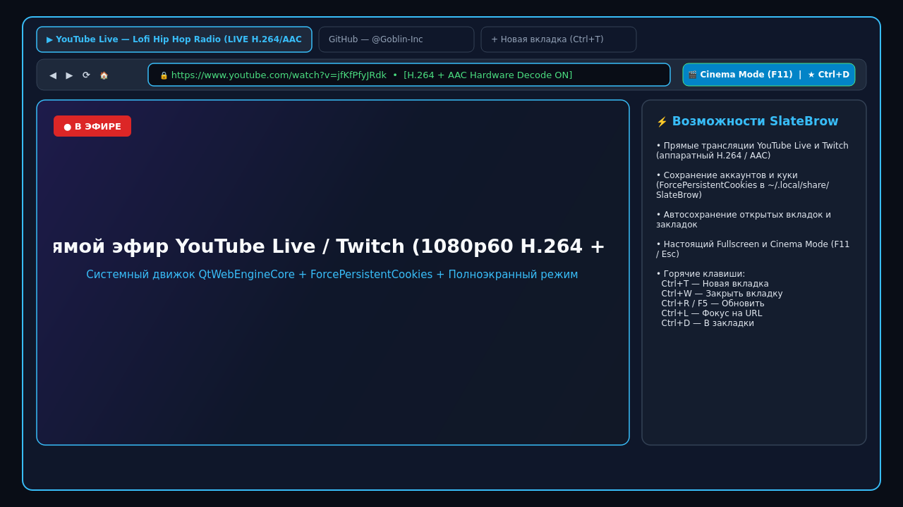

<div align="center">

🌐 **Language:** **English** | [Русский (README_Ru.md)](README_Ru.md)

# 🌐 SlateBrow

**Minimalist Dark Slate desktop web browser with hardware-accelerated live stream decoding (`H.264/AAC`), Cinema Mode, and persistent sessions**

[](https://python.org)
[](https://doc.qt.io/qt-6/qtwebengine-index.html)
[](#)
[](https://github.com/Goblin-Inc/SlateBrow/releases)

<br/>



</div>

---

## 📖 Overview

**SlateBrow** is a fast, clutter-free, zero-telemetry desktop web browser built on **PySide6 / QtWebEngine (Chromium)**, designed for smooth video playback, live streams, and everyday browsing in a dark Linux desktop environment.

Unlike standard PySide6 wheels from PyPI (where proprietary media codecs are disabled), **SlateBrow** directly leverages the system `QtWebEngineCore` engine with hardware-accelerated **H.264 / AAC / MSE / WebRTC** decoding, ensuring **YouTube Live, Twitch, and VK Play Live** play smoothly without playback errors.

### ✨ Key Features
- **Full Live Stream & Video Support (`H.264 / AAC / Widevine`)**:
  - Pre-configured Chromium flags: `ignore-gpu-blocklist`, `enable-gpu-rasterization`, `enable-zero-copy`, and `autoplay-policy=no-user-gesture-required`.
  - Smooth 1080p60/4K60 video and YouTube / Twitch live stream playback.
- **Persistent Profile & Automatic Tab Restoration**:
  - Enforced persistent cookies (`ForcePersistentCookies`), `LocalStorage`, and cache stored in `~/.local/share/SlateBrow/`.
  - Keeps you signed in to Google, YouTube, GitHub, and Twitch across browser restarts.
  - All open tabs are automatically saved to `session.json` and restored on the next launch.
- **True Fullscreen & Cinema Mode (`F11`)**:
  - Full HTML5 Fullscreen API support (`FullScreenSupportEnabled`) — clicking the fullscreen button in YouTube/Twitch players automatically hides the tab bar and address bar, while `Esc` or `F11` brings them back.
- **Download Manager & Page Zoom**:
  - Built-in download progress bar (`~/Downloads`) and smooth page zooming (`Ctrl +` / `Ctrl -` / `Ctrl 0`).

---

## ⌨️ Keyboard Shortcuts

| Shortcut | Action |
|---|---|
| `Ctrl + T` | Open a new tab |
| `Ctrl + W` | Close current tab |
| `Ctrl + R` / `F5` | Reload page |
| `Ctrl + L` | Focus address bar (enter a URL or Google search query) |
| `F11` | Toggle Fullscreen / Cinema Mode (auto-hides toolbar and tab bar) |
| `Esc` | Exit fullscreen video or window mode |
| `Alt + ←` / `Alt + →` | Navigate Back / Forward in tab history |
| `Ctrl + +` / `Ctrl + -` / `Ctrl + 0` | Zoom In / Zoom Out / Reset page zoom (`100%`) |

---

## 🏗️ Project Architecture

```
SlateBrow/
├── main.py          # Entry point, Chromium/GPU flags setup, and profile initialization
├── browser.py       # Browser core: tab management, sessions, cookies, Fullscreen API, and downloads
├── styles.py        # Signature Slate Dark theme (#0d0f12 / #161920)
├── run.sh           # Launch script using system QtWebEngine (with H.264/AAC codec support)
└── requirements.txt # Environment dependencies
```

---

## 📦 Installation & Usage

### Option 1: Install from `.deb` package (Recommended for Debian/Ubuntu)
Go to [**Releases**](https://github.com/Goblin-Inc/SlateBrow/releases), download `slatebrow_1.0.0_amd64.deb`, and run:

```bash
sudo dpkg -i slatebrow_1.0.0_amd64.deb
sudo apt-get install -f
```
Once installed, **SlateBrow** will appear in your application launcher and can be started via the `slatebrow` command.

### Option 2: Arch Linux (`pacman`) / Universal Source Installation
```bash
git clone https://github.com/Goblin-Inc/SlateBrow.git
cd SlateBrow

# Automated installer (automatically detects Arch Linux pacman or Ubuntu/Debian apt):
./install.sh

# Or manually on Arch Linux:
sudo pacman -S python pyside6 qt6-webengine qt6-multimedia-ffmpeg
./run.sh

# Or manually on Ubuntu / Debian:
sudo apt install python3-pyside6.qtwebenginewidgets python3-pyside6.qtwebenginecore
./run.sh
```

---

## 📋 Changelog

### `v1.0.0` — SlateBrow Release with Live Stream Support & Cinema Mode *(Current)*
- **Added**: Hardware video acceleration and `H.264/AAC` codec support for YouTube Live and Twitch streams.
- **Added**: Persistent storage (`ForcePersistentCookies`) and automatic tab session saving in `~/.local/share/SlateBrow/session.json`.
- **Added**: Full HTML5 Fullscreen API + `F11` Cinema Mode with auto-hidden UI chrome.
- **Added**: `.deb` installer and portable package in GitHub Releases.

---

<div align="center">
Developed by <a href="https://github.com/Goblin-Inc">@Goblin-Inc</a> • <a href="README_Ru.md">Русская версия</a>
</div>
